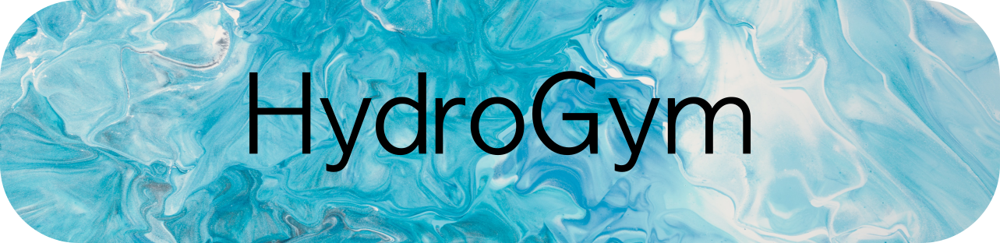

<p align="center">
<a rel="nofollow"></a>
</p>

<p align="center">
<a href="https://github.com/astral-sh/ruff"></a>
<a href="https://python.org/"></a>
<a href="https://spdx.org/licenses/MIT.html"></a>
<a href="https://join.slack.com/t/hydrogym/shared_invite/zt-27u914dfn-UFq3CkaxiLs8dwZ_fDkBuA"></a>
</p>

# HydroGym: Reinforcement Learning for Fluid Dynamics

**96 environments | 7 solver backends | 2D & 3D | Ready for RL training**

HydroGym is a comprehensive platform for applying reinforcement learning to fluid dynamics and flow control. With environments ranging from canonical benchmarks to turbulent flows, HydroGym provides a standardized Gymnasium-compatible interface for training RL agents on challenging CFD problems.

## Key Features

- **Diverse Environments**: 96 pre-configured environments across 7 CFD solvers
- **Standard RL Interface**: Gymnasium-compatible API works with Stable-Baselines3, RLlib, and other RL libraries
- **Compute Efficient**: Highly optimized GPU & CPU backends for efficient RL deployment ranging from local workstations to exascale HPC systems
- **Scalable**: MPI-parallelized solvers for large-scale HPC deployment (MPMD co-launch of RL and solver processes)
- **Multiple Backends**: Finite Element (Firedrake), Lattice Boltzmann (MAIA LBM), Finite Volume (MAIA FV), Spectral Element (NEK5000 on CPUs, NekRS on GPUs), Fully Differentiable solvers (JAX, JAX-Fluids)
- **2D & 3D**: From simple 2D benchmarks to complex 3D turbulent flows (Re up to 400,000)
- **Research-Ready**: Managed by a complementary HuggingFace repository

## Quick Start: `gym.make()`

**The standard way to start any HydroGym environment is gymnasium's
`gym.make()`** — one call, the same shape regardless of backend:

```python
import gymnasium as gym
import hydrogym.registration  # registers HydroGym's environment ids

env = gym.make("hydrogym/Cylinder-v0")
obs, info = env.reset()
for _ in range(100):
    action = env.action_space.sample()
    obs, reward, terminated, truncated, info = env.step(action)
env.close()
```

The exact same shape works for every gymnasium-API backend — only the id
(and, for MAIA/Nek, the MPMD launch command underneath) changes:

| Backend | id | Launch |
|---|---|---|
| Firedrake | `hydrogym/Cylinder-v0`, `RotaryCylinder`, `Cavity`, `Pinball`, `Step` | `python script.py` |
| MAIA | `hydrogym-maia/Cylinder_2D_Re200-v0` (zero extra args) | `mpirun -np 1 python script.py : -np N maia properties_run.toml` |
| NEK5000 | `hydrogym-nek/TCFmini_3D_Re180-v0` (`nproc=` required) | `mpirun -np 1 python script.py : -np N nek5000` |
| JAX-Fluids | `hydrogym-jaxfluids/Nozzle2D-v0`, `Nozzle3D` | `python script.py` |

Runnable reference scripts for each: [`examples/firedrake/getting_started/gym_make_demo.py`](examples/firedrake/getting_started/gym_make_demo.py),
[`examples/maia/getting_started/gym_make_demo.py`](examples/maia/getting_started/gym_make_demo.py),
[`examples/nek/getting_started/gym_make_demo.py`](examples/nek/getting_started/gym_make_demo.py),
[`examples/jaxfluids/gym_make_demo.py`](examples/jaxfluids/gym_make_demo.py).

`gym.make()` accepts the same settings as the classes — pass `env_config={...}` (Firedrake,
JAX-Fluids) or backend-native kwargs (MAIA, Nek) to override any default,
same as constructing the environment directly. MAIA ids other than
`Cylinder_2D_Re200` have no universal default probe grid and require
`probe_locations=[...]`; `gym.make()` raises a clear error naming this if
it's missing, rather than guessing at flow-geometry-specific defaults.

**JAX stays outside `gym.make()` by design.** It implements a
functional/JIT (`gymnax`-style) contract — `jax.jit(env.reset_env)` /
`jax.jit(env.step_env)`, not `gymnasium.Env`'s `reset()`/`step()` — because
the JAX backend is meant to be traceable through
`jax.jit`/`jax.vmap`/`jax.lax.scan`, which a `self`-mutating
`gymnasium.Env` cannot be. Wrapping it in `gym.make()` would present a
misleading API. Use `hydrogym.jax.envs.*` directly — see
[`examples/jax/getting_started/`](examples/jax/getting_started/).

### Lower-level entry points

`gym.make()` is a thin, optional layer over each backend's own native
construction path — every one of them remains fully available, for direct
solver access, open-loop control, custom flow/solver classes, or anything
`gym.make()`'s registered defaults don't cover:

- **Firedrake**: `hydrogym.firedrake.Cylinder` + `hydrogym.core.FlowEnv`
  directly, or `hydrogym.firedrake.NewtonSolver`/`SemiImplicitBDF` on a
  bare flow object for non-RL workflows (steady-state solves, stability
  analysis) — see [`examples/firedrake/advanced/`](examples/firedrake/advanced/).
- **MAIA**: `hydrogym.maia.from_hf(...)` — see [`examples/maia/getting_started/test_maia_env.py`](examples/maia/getting_started/test_maia_env.py).
- **NEK5000**: `hydrogym.nek.NekEnv.from_hf(...)` / `NekEnv(env_config=...)` — see [`examples/nek/getting_started/`](examples/nek/getting_started/).
- **JAX-Fluids**: `hydrogym.jaxfluids.envs.Nozzle2D(env_config=...)` directly.
- **JAX**: the functional API is always the entry point (there is no
  higher-level wrapper to bypass) — see [`examples/jax/getting_started/`](examples/jax/getting_started/).

## Quick Start with Docker (Recommended)

**We strongly recommend using our pre-built Docker images.** They have the
HydroGym backends built in, with MPI, CUDA and the Python environment:

```bash
# NVIDIA GPUs (x86_64, cc75-cc120: T4, RTX 20-50, A100, A6000, L40, H100, H200, B200, ...;
# NVIDIA driver >= 525): m-AIA, NekRS, Nek5000, JAX, JAX-Fluids
docker pull clagemann/hydrogym-nvhpc-26.5_cuda-12.9:1.0.2
docker run -it --gpus all --ipc=host clagemann/hydrogym-nvhpc-26.5_cuda-12.9:1.0.2

# CPU only (x86_64): all backends, including Firedrake
docker pull clagemann/hydrogym-cpu:1.0.2
docker run -it --ipc=host clagemann/hydrogym-cpu:1.0.2
```

Inside, `python` is the HydroGym environment (`/opt/venvs/hydrogym`), `maia`,
`nekrs`, `nekrs-mpmd` and `mpirun` are on the `PATH`, the Nek5000 case
executables are in `/opt/nek5000/cases/<case>/nek5000`, and the HydroGym
sources and examples are in `/opt/hydrogym`. Firedrake (CPU image) has its own
environment, `source /opt/venvs/firedrake/bin/activate`. On clusters, convert
the images with `apptainer pull docker://...`; for NVIDIA GH200 nodes
(aarch64) build the Apptainer image from `.devcontainer/release/apptainer/`,
and for AMD GPUs the ROCm image with `.devcontainer/scripts/build_rocm_image.sh`.

See [Container images](docs/docs/installation/containers.md) for the
contents, Apptainer use and operational notes, and
[.devcontainer/README.md](.devcontainer/README.md#release-images-self-contained)
for building the images and the matching devcontainer configurations.

### Installing from PyPI or from source

HydroGym needs Python 3.11 or newer.

```bash
pip install hydrogym              # core; solver extras: hydrogym[firedrake|maia|nek|nekrs|jax|jaxfluids|all]

git lfs install                   # from source: once per machine, before cloning
git clone https://github.com/dynamicslab/hydrogym.git
cd hydrogym && pip install -e ".[jax]"   # or uv sync --locked --extra jax
```

The pretrained policies (`policies/`) are part of the repository, not of the PyPI package.

The solver sources under `third_party/` are git submodules. They are only needed to build a solver from source (the
container images ship them built), so a plain `git clone` is enough for the Python package. Initialise a single one
when you need it, e.g. `git submodule update --init third_party/m-AIA`. Do not use `--recurse-submodules` or
`--recursive`: m-AIA contains a nested submodule that is not publicly accessible, so the recursive clone fails.

> Git LFS: the Firedrake meshes (`hydrogym/firedrake/envs/*/*.msh`) and the Nek5000 case files (`third_party/nek5000/cases/`) are stored with [Git LFS](https://git-lfs.com). Run `git lfs install` before cloning, or `git lfs pull` in an existing clone; otherwise these files are small pointer files and HydroGym stops with "... is a Git LFS pointer". The wheels on PyPI contain the meshes.

## Available Environments

HydroGym provides **96 environments** across 7 solver backends. An environment is one folder of the
[Hugging Face dataset](https://huggingface.co/datasets/dynamicslab/HydroGym-environments) that holds data (flow,
Reynolds number, dimension, mesh or grid variant); three more (m-AIA finite volume) are coming soon. The two NekRS cases are
GPU implementations of NEK5000 cases and are set up from `examples/nekrs`. The full list is generated from the dataset
by `scripts/gen_env_table.py` and is in [docs/docs/environments.md](docs/docs/environments.md).

| Solver Backend | Count | Description | Dimensions |
|----------------|-------|-------------|------------|
| **Firedrake** (FEM) | 25 | Canonical flow control benchmarks | 2D |
| **MAIA LBM** | 59 | Lattice Boltzmann method environments | 2D, 3D |
| **MAIA Structured FV** | 1 (+3 coming soon) | High-Reynolds-number airfoil and turbulent boundary-layer flows: DRA2303 airfoil at Ma 0.2 with jets today; the Ma 0.7 and surface-wave variants, and the zero-pressure-gradient boundary layer (`ZPGTBL*`), are coming soon | 3D |
| **NEK5000** | 5 | Spectral element turbulent channel/airfoil flow | 3D |
| **NekRS** | (2) | GPU spectral element: the NEK5000 turbulent channel and NACA0012 wing | 3D |
| **JAX** | 2 | Differentiable fluid dynamics | 2D, 3D |
| **JAX-Fluids** | 4 | Compressible shock vector control | 2D, 3D |

### Environment Categories

**Canonical Benchmarks** (Low-Mid Re):
- Cylinder wake (Re=100-3900, 2D/3D)
- Rotating cylinder (Re=100-3900, 2D/3D)
- Pinball (Re=30-150, 2D/3D)
- Cavity flow (Re=4200-7500, 2D/3D)
- Backward-facing step (Re=600, 2D)
- Square cylinder (Re=200-3900, 2D/3D)
- Sphere (Re=300-3700, 3D)
- Cube (Re=300-3700, 3D)
- Turbulent channel flow (Re_tau=180 and 207, 3D)

**Airfoil Control**:
- NACA0012 steady (Re=100-50000, AOA=12-40°, 2D/3D)
- NACA0012 with gust disturbance (Re=100-50000, 2D/3D)

**High Reynolds Number Flows**:
- DRA2303 airfoil with jet actuation (Re=400000, Ma=0.2, 3D); Ma 0.7 and surface-wave actuation: coming soon
- Zero-pressure-gradient turbulent boundary layer with jet/surface wave actuation (Re_Tau=180-2200, 3D): coming soon
- NACA0012 airfoil with jet actuation (Re=200000, 3D)

**Fully Differentiable Flows**:
- Shock-Vector Control in single divergent nozzle (SVC, Ma>1.0, 2D/3D)
- Turbulent channel flow (Re_tau=180, 3D)
- Kolmogorov flow (up to Re=1000, 2D)

## Environment Checkpoints

All required environment checkpoints are available via [HuggingFace](https://huggingface.co/datasets/dynamicslab/HydroGym-environments/tree/main) and are downloaded on the fly when an environment is first created (internet connection required). If no internet connection is available at runtime — e.g. on compute nodes in HPC clusters — you can pre-download the environment files as outlined in [examples/maia/README.md](examples/maia/README.md).

## Examples

HydroGym includes comprehensive examples for each solver backend (internet connection required). We highly recommend using our provided docker containers.
In the containers the examples are in `/opt/hydrogym/examples`, which is not writable for a non-root user (e.g. under
Apptainer or `docker run --user`), and the examples write into their directories: copy them first
(`cp -r /opt/hydrogym/examples ~/hydrogym-examples`) and run them from the copy.
Each backend's `getting_started/` directory includes a `gym_make_demo.py`
(the standard entry point above) alongside the backend-specific,
lower-level scripts below (direct construction, SB3 training loops,
multi-agent wrappers) — start with `gym_make_demo.py` unless you need
what a specific lower-level script demonstrates.

### Firedrake Examples

See [examples/firedrake/getting_started/](examples/firedrake/getting_started/) for detailed documentation.

```bash
cd examples/firedrake/getting_started

# Test environment interactively
./run_example_docker.sh

# Train with Stable-Baselines3
./run_example_docker.sh train
```

### MAIA Examples

See [examples/maia/getting_started/](examples/maia/getting_started/) for MPMD coupling details.

```bash
cd examples/maia/getting_started

# Prepare workspace (downloads from Hugging Face Hub) and 
# Run with MPMD execution (1 Python + 1 MAIA process on GPU)
./run_example_docker.sh

# Prepare workspace and train with Stable-Baselines3
./run_example_docker.sh train
```

### NEK5000 Examples

See [examples/nek/getting_started/](examples/nek/getting_started/) for interface patterns.

```bash
cd examples/nek/getting_started

# Test single-agent environment
cd 1_nekenv_single
./run_nekenv_docker.sh

# ... or train with the PettingZoo wrapper and SB3
cd ../3_pettingzoo
./run_pettingzoo_docker.sh train

# ... or run zero-shot transfer learning
cd ../6_zeroshot_wing_demo
./run_pettingzoo_docker.sh
```

### JAX Examples

See [examples/jax/getting_started/](examples/jax/getting_started/) for detailed documentation.

```bash
cd examples/jax/getting_started

# Test Kolmogorov flow environment
cd 1_kolmogorov
./run_kolmogorov_docker.sh

# ... or test channel flow environment
cd ../2_channel
./run_channel_docker.sh strong_actuation

# ... or train PPO
cd ../3_ppo
./run_ppo_docker.sh --env kolmogorov   # getting-started settings, ~10-15 min on a CPU
```

## Training RL Agents

HydroGym works with standard RL libraries. Example with Stable-Baselines3,
built on `gym.make()`:

```python
import gymnasium as gym
import hydrogym.registration
from stable_baselines3 import PPO
from stable_baselines3.common.vec_env import DummyVecEnv, VecNormalize


# Create environment (env_config overrides gym.make()'s registered defaults)
def make_env():
    return gym.make(
        "hydrogym/Cylinder-v0",
        env_config={
            "flow_config": {"mesh": "medium", "Re": 100},
            "solver_config": {"dt": 1e-2},
            "actuation_config": {"num_substeps": 2},
        },
    )


# Vectorize and normalize
env = DummyVecEnv([make_env])
env = VecNormalize(env, norm_obs=True, norm_reward=True)

# Train
model = PPO("MlpPolicy", env, verbose=1)
model.learn(total_timesteps=100000)
```

Constructing `hydrogym.core.FlowEnv`/backend-native factories
(`hydrogym.maia.from_hf`, `NekEnv.from_hf`, ...) directly works exactly
the same way and remains fully supported — `gym.make()` is a thin,
optional layer on top, not a replacement; see "Lower-level entry points"
above. See also provided [examples/](examples/) for more details how to
leverage individual solver backends for training.

## Advanced Features

- **Checkpoint management**: Automatic loading from Hugging Face Hub
- **Custom observations**: Force sensors, velocity/pressure/vorticity probes, stress sensors
- **Callbacks**: Checkpointing, logging, Paraview export
- **Stability analysis**: Global stability analysis via SLEPc (Firedrake)
- **Modal decompositions**: DMD, POD via modred (Firedrake)
- **Multi-agent RL**: PettingZoo interface for distributed actuation (NEK5000)

## Documentation

- **Getting Started Guides**: See `examples/[backend]/getting_started/README.md`
- **API Documentation**: [https://dynamicslab.github.io/hydrogym](https://dynamicslab.github.io/hydrogym)
- **Paper**: Lagemann et al., *Nature* 657, 369–376 (2026), [doi:10.1038/s41586-026-10917-6](https://doi.org/10.1038/s41586-026-10917-6) (preprint: [arXiv:2512.17534](https://arxiv.org/abs/2512.17534))

## Citation

If you use HydroGym in your research, please cite the following two papers:

```bibtex
@inproceedings{lagemann2025hydrogym,
  title={HydroGym: A Reinforcement Learning Platform for Fluid Dynamics},
  author={Lagemann, Christian and Paehler, Ludger and Callaham, Jared and Mokbel, Sajeda and Ahnert, Samuel and Lagemann, Kai and Lagemann, Esther and Adams, Nikolaus and Brunton, Steven},
  booktitle={7th Annual Learning for Dynamics \& Control Conference},
  pages={497--512},
  year={2025},
  organization={PMLR}
}
@article{lagemann2026hydrogym,
  title={The HydroGym reinforcement learning platform for fluid dynamics},
  author={Lagemann, Christian and Mokbel, Sajeda and Gondrum, Miro and R{\"u}ttgers, Mario and Wang, Yuning and Su{\'a}rez, Pol and Paehler, Ludger and Bezgin, Deniz A. and Buhendwa, Aaron B. and Callaham, Jared L. and Ahnert, Samuel and Zolman, Nicholas and Shao, Xiao and Loiseau, Jean-Christophe and Adams, Nikolaus A. and Meinke, Matthias and Schr{\"o}der, Wolfgang and Lagemann, Kai and Lagemann, Esther and Vinuesa, Ricardo and Brunton, Steven L.},
  journal={Nature},
  volume={657},
  pages={369--376},
  year={2026},
  doi={10.1038/s41586-026-10917-6},
  note={Preprint: arXiv:2512.17534}
}
```

## License

HydroGym is released under the MIT License. See [LICENSE](LICENSE) for details.
