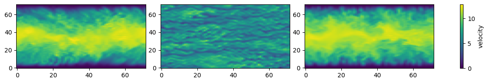
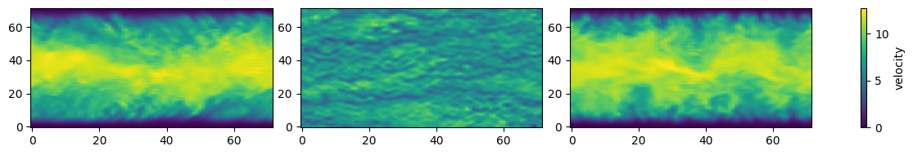

# Turbulent Channel (pseudo-spectral, legacy)

:::note
This is the earlier JAX channel of HydroGym, `ChannelFlowSpectralEnv`, selected with
`ChannelFlowEnv({"solver": "spectral"})`. It is a different solver and a different flow than the finite-difference
channel at $Re_\tau = 180$ (`solver="fd"`, the default, see [the finite-difference channel](channel_fd.md)). Its
stored flow has the bulk velocity $U_b = 8.0$ and the body force $f_x = 2.0$; the wall shear stress of the stored field
corresponds to $Re_\tau \approx 310$ ($u_\tau \approx 0.6$, $\nu = 1.9\times10^{-3}$, half-height 1), not 180. The
`Channel_3D_Retau180` data keep their name.
:::

The legacy channel is a 3D channel flow in [JAX](https://docs.jax.dev/en/latest/notebooks/thinking_in_jax.html) of size $[2\pi, \pi, 2]$, where $z$ is the wall-normal direction. The grid is $72^3$ with Fourier modes in $x$ and $y$ and Chebyshev-Gauss-Lobatto points in $z$ (the wall nodes are grid points), advanced with a pseudo-spectral Runge-Kutta scheme at the fixed time step $2\times10^{-4}$ and a constant mass flux. It is pre-configured to be controlled with 24 wall-normal jets on the bottom wall. The observation consists of evenly spaced $u$ and $w$ values on the wall-parallel plane with index `k_det` = 9, and the reward is $-\tau_w$.

## Initializing the Environment

To begin setting up the environment, we first have to import JAX, the necessary modules from HydroGym. Then we will be able to construct the environment, and work with it.

```python
import jax
import jax.numpy as jnp
import matplotlib.pyplot as plt

# Import channel flow and environment configuration
from hydrogym.jax.envs.channel import ChannelFlowSpectralEnv   # or ChannelFlowEnv({"solver": "spectral"})

env_config = {}
env = ChannelFlowSpectralEnv(env_config)
params = env.default_params
```

to have a clean working environment, we will also need to reset the environment to its initial conditions. These are provided in the [HuggingFace initial fields folder](https://huggingface.co/datasets/dynamicslab/HydroGym-environments).

```python
key = jax.random.PRNGKey(0)
obs, state = env.reset_env(key, params)
print("Initial state shape U:", state.U.shape)
print("Initial state shape V:", state.V.shape)
print("Initial state shape W:", state.W.shape)
print("Initial mean observation value: ", jnp.mean(obs))
```

at which point we can begin to run the environment.

## A First Environment Step

To now interact with the environment, we need to define an action we wish to take. For this we can rely on the default parameters provided by the environment to give us the right dimensions.

```python
action = jnp.zeros((params.action_dim,))
```

Now we can step the environment forward by providing the action to the environment.

```python
obs, state, reward, done, info = env.step_env(key, state, action, params)

print("Mean observation value: ", jnp.mean(obs))
print("Reward:", reward)
```

This prints the mean of the observation and the reward of the step.

## Visualizing U without Control

After running the environment step, the state class contains (U,V,W) fields which can be accessed and visualized:

```python
U = state.U
y_idx = 36
z_idx = 8
x_idx = 36
U_slice_xz = U[:, y_idx, :]
U_slice_xy = U[:, :, z_idx]
U_slice_yz = U[x_idx, :, :]

fig, axes = plt.subplots(1, 3, figsize=(10, 2))
slices = [U_slice_xz, U_slice_xy, U_slice_yz]

vmin = min(s.min() for s in slices)
vmax = max(s.max() for s in slices)

for (
    ax,
    slice_,
) in zip(axes, slices):
    im = ax.imshow(
        slice_.T,
        origin="lower",
        aspect="auto",
        vmin=vmin,
        vmax=vmax,
    )
fig.subplots_adjust(right=0.9)

plt.tight_layout(rect=[0, 0, 1.25, 1])
fig.colorbar(im, ax=axes, label="velocity")
plt.show()
```



At which point we can also explore the performance of the jets (positive action = suction). Here we will perform $6$ steps in the environment, and then inspect the mean observation values and rewards after each step.

```python
key = jax.random.PRNGKey(0)
obs, state = env.reset_env(key, params)

# action = jax.random.normal(key, (params.action_dim,))
action = 0.01 * jnp.ones((params.action_dim,))
num_steps = 6

for i in range(num_steps):
    obs, state, reward, done, info = env.step_env(key, state, action, params)
    print("Mean observation value after environment step: ", jnp.mean(obs))
    print("Reward:", reward)
```

This prints the mean observation and the reward of every step. The jets are a zero-net-mass-flux wall transpiration
velocity, and zero action is the uncontrolled channel; `ChannelFlowSpectralEnv({"legacy_jets": True})` selects the jet
model of HydroGym ≤ 1.0.

## Visualizing U after a few Steps in the Environment with Control

To visualize the flow after a few steps in the environment with control, we can use the same code as above, i.e.

```python
U = state.U
y_idx = 36
z_idx = 9
x_idx = 36
U_slice_xz = U[:, y_idx, :]
U_slice_xy = U[:, :, z_idx]
U_slice_yz = U[x_idx, :, :]

fig, axes = plt.subplots(1, 3, figsize=(10, 2))
slices = [U_slice_xz, U_slice_xy, U_slice_yz]

vmin = min(s.min() for s in slices)
vmax = max(s.max() for s in slices)

for (
    ax,
    slice_,
) in zip(axes, slices):
    im = ax.imshow(
        slice_.T,
        origin="lower",
        aspect="auto",
        vmin=vmin,
        vmax=vmax,
    )
fig.subplots_adjust(right=0.9)

plt.tight_layout(rect=[0, 0, 1.25, 1])
fig.colorbar(im, ax=axes, label="velocity")
plt.show()
```


