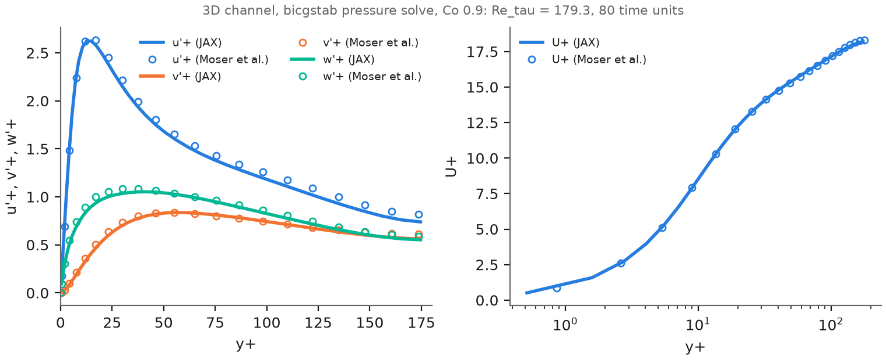

# Turbulent Channel (finite differences)

`ChannelFlowFDEnv` is the differentiable three-dimensional turbulent channel of HydroGym at $Re_\tau = 180$. It is a
finite-difference direct numerical simulation written in [JAX](https://docs.jax.dev/), with a fractional-step
projection, an explicit Runge-Kutta scheme and a pressure Poisson solve that is exact by default (FFT and tridiagonal
solve, float32) or iterative with [lineax](https://docs.kidger.site/lineax/) BiCGStab (float64). The flow is controlled with 24 zero-mass-flux wall jets and the
reward is the reduction of the wall shear stress. `ChannelFlowEnv(env_config)` is the entry point of the channel
environments: `env_config["solver"]` is `"fd"` (this channel, the default) or `"spectral"` (the earlier
pseudo-spectral channel, see [the legacy channel](channel.md)).

The discretisation follows the three-dimensional channel code of Vuorinen and Keskinen, *DNSLab: A gateway to turbulent
flow simulation in Matlab*, Comput. Phys. Commun. **203** (2016) 278-289
([doi:10.1016/j.cpc.2016.02.023](https://doi.org/10.1016/j.cpc.2016.02.023), program AEZX_v1_0, `Channel3dLab`). The
solver is a re-implementation in JAX with matrix-free stencils; its operators reproduce the sparse matrices shipped
with DNSLab to round-off (see [Validation](#validation)).

## Setup

| | |
|---|---|
| Domain | $2\pi \times \pi \times 2$ ($x$ streamwise, $y$ spanwise, $z$ wall-normal), periodic in $x$ and $y$, no slip at $z = 0$ and $z = 2$ |
| Grid | $72 \times 72 \times 72$ cells (cell-centred); uniform in $x$ and $y$, $\tanh$-stretched in $z$ (`ctanh = 0.05`); a ghost cell of the neighbouring width on each side of the wall-normal direction |
| Viscosity, forcing | $\nu = 1.9\times10^{-3}$; constant body force $f_x = 8\nu^2 Re_\tau^2/H^3 = 0.116964$ ($H = 2$) |
| Time stepping | explicit Runge-Kutta (classical fourth order, `rk_order` 1 to 4), projection after every stage; dynamic time step for a maximum Courant number of `cfl = 0.9` (DNSLab's default is 0.5) |
| Pressure | $M p = D_x u + D_y v + D_z w$, zero normal gradient at the walls, pinned to zero on one bottom-wall face; solved exactly by default (`poisson_solver="direct"`), or with `lineax.BiCGStab` in float64 (`poisson_solver="bicgstab"`: matrix-free, relative residual `pressure_tol = 1e-3`, warm start from the previous pressure) |

Arrays have the shape $(n_x, n_y, n_z)$ with $z$ last. DNSLab stores $(N_1, N_2, N_3)$ = (span, length, wall-normal
with ghost cells), so a DNSLab array is the HydroGym array with the first two axes swapped; the velocity components
$u, v, w$ are the streamwise, spanwise and wall-normal components in both.

The solver (`hydrogym.jax.solvers.channel_fd.ChannelFD`) consists of pure functions of the state and can be used
without the environment:

```python
import jax
from hydrogym.jax.solvers.channel_fd import ChannelFD, ChannelFDConfig

solver = ChannelFD(ChannelFDConfig(cfl=0.9))        # float32, exact (direct) pressure solve
# float64 with lineax BiCGStab (the module does not enable x64 itself):
#   jax.config.update("jax_enable_x64", True)
#   solver = ChannelFD(ChannelFDConfig(dtype="float64", poisson_solver="bicgstab"))
state = solver.init_state(u0, v0, w0)               # projects the initial field
state, aux = solver.run(state, 1000)                # lax.scan; aux: dt, courant, Poisson iterations
tau_w = solver.wall_shear(state.u, "mean")
```

### Pressure solver options

- `poisson_solver="direct"` (default): the Poisson operator is separable (constant coefficients in $x$ and $y$), so the
  discrete problem is solved exactly with a Fourier transform in $x, y$ and a tridiagonal solve in $z$. It is about
  10 to 20 times faster per step than BiCGStab and agrees with a converged BiCGStab solution to $3\times10^{-8}$. It is
  the solver of the default float32 precision and works in float64 as well; reverse-mode gradients go through it.
- `poisson_solver="bicgstab"` (float64 only): lineax BiCGStab as in the description of the channel (relative residual
  `pressure_tol`, no preconditioner by default); reverse-mode gradients use lineax's implicit differentiation.
  `preconditioner="diag"` adds a Jacobi preconditioner (no gain was measured). In float32 the iteration of this operator is
  not reliable (see [Actuation](#actuation)), so the combination with `dtype="float32"` is rejected.
- If `lineax` is not installed, `jax.scipy.sparse.linalg.bicgstab` is used for the float64 BiCGStab solve.

## Environment

```python
import jax, jax.numpy as jnp
from hydrogym.jax.envs.channel_fd import ChannelFlowEnv

env = ChannelFlowEnv({"solver": "fd"})              # needs the Channel_3D_Retau180_JAXFD data (or initial_field_dir)
params = env.default_params
key = jax.random.PRNGKey(0)
obs, state = env.reset(key, params)
obs, state, reward, done, info = env.step(key, state, jnp.zeros(params.action_dim), params)
```

| Item | Definition |
|---|---|
| Action | 24 numbers in $[-1, 1]$, one per jet (6 × 4 layout, the centres of the pseudo-spectral channel; `nx_jets`, `ny_jets`), held for `nsteps` solver steps (default 100; 50 to 150 are meaningful). Positive action is suction. |
| Jets | wall-normal velocity on the bottom wall, parabolic in the distance $r$ from the jet centre, $w = g\,(a - \bar a)(1 - r^2/R^2)$ inside the radius $R$ (`jet_radius`, default 0.25), zero outside. $g$ = `jet_amplitude` $\times\, u_\tau$ with `jet_amplitude` = 0.0624 (the peak velocity per unit action in units of the nominal friction velocity $u_\tau = \sqrt{f_x H/2} = 0.342$, i.e. $g = 0.0213$; `jet_gain` sets $g$ in absolute units); the area-weighted mean action $\bar a$ is removed, so the net mass flux is exactly zero and every jet is zero at its edge. |
| Observation | streamwise velocity $u$ at the 24 jet centres on the wall-parallel plane of cell centres closest to $y^+ = 15$ (`obs_yplus`; with the nominal $u_\tau = \sqrt{f_x H/2}$) |
| Reward | $\tau_\mathrm{ref}/\tau_w$ (`reward="ratio"`, default) or $-\tau_w$ (`reward="neg_tau"`). $\tau_w = \nu\langle u\rangle(z_1)/z_1$ is the mean over the controlled (bottom) wall from the first cell ($y^+ \approx 0.5$, viscous sub-layer) at the end of the action interval; $\tau_\mathrm{ref}$ (`tau_ref`) is the value of the uncontrolled flow. |
| Initial state | `initial_condition="turbulent"` (default): fields from `Channel_3D_Retau180_JAXFD` or `initial_field_dir`; `"laminar"`: a parabolic profile of bulk velocity `u_bulk_init` plus a random perturbation (relative amplitude `perturbation`) generated at every reset (many time units are needed to become turbulent) |
| `info` | `wall_shear_stress`, `obs_yplus` (of the measured friction velocity), `poisson_iterations`, `courant`, and the actuation power entries of the other environments (`actuation_power*`, `drag_coefficient`, `objective`) |

The step is differentiable with respect to the action (`jax.grad` through `step_env`). `dtype` is `"float32"` by
default (with the exact pressure solve); `"float64"` needs `jax.config.update("jax_enable_x64", True)` before the environment is built. Importing the
finite-difference modules does not change that setting (the pseudo-spectral channel module does).

## Validation

### Operators and time integration

The ten operators ($D_x, D_y, D_z, D_{xx}, D_{yy}, D_{zz}$, the three pressure-gradient operators and the Poisson
operator $M$) agree with the sparse matrices shipped with DNSLab to $3\times10^{-14}$ on random and turbulent fields, and
the time integration agrees with a line-by-line transcription of the DNSLab time step to round-off. The unit tests
(`test/test_jax_channel_fd_solver.py`) check the same operators against matrices assembled by explicit loops, the
Runge-Kutta order (1 to 4) on a linear problem, the second-order convergence of the laminar Poiseuille solution, and
the reverse-mode gradient against central finite differences (relative difference $5\times10^{-5}$ with BiCGStab,
$6\times10^{-8}$ with the direct solver).

### Turbulence statistics

A float64 run from a turbulent field, 20 time units of spin-up discarded and 80 time units
($27\,h/u_\tau$) averaged, with the documented solver (`dtype="float64"`, `poisson_solver="bicgstab"`, Courant number 0.9), against the DNS of
Moser, Kim and Mansour (1999) at $Re_\tau = 178$:



| | JAX, BiCGStab, Co 0.9 | JAX, direct solver, Co 0.9 | JAX, direct solver, Co 0.5 | Moser et al. |
|---|---|---|---|---|
| $Re_\tau$ (first-cell wall shear, both walls) | 179.3 | 179.3 | 179.5 | 178.1 |
| $U^+$ centreline | 18.18 | 18.15 | 18.20 | 18.30 |
| $U^+$ maximum deviation, $y^+>5$ | 0.66 % | 0.79 % | 0.55 % | |
| $u'^+$ peak | 2.62 (-1.3 %) | 2.65 (-0.2 %) | 2.61 (-2.0 %) | 2.66 |
| $v'^+$ peak (wall-normal) | 0.837 (+0.1 %) | 0.839 (+0.4 %) | 0.834 (-0.3 %) | 0.836 |
| $w'^+$ peak (spanwise) | 1.053 (-3.2 %) | 1.049 (-3.5 %) | 1.052 (-3.3 %) | 1.087 |
| $-\overline{u'v'}^+$ peak | 0.717 (-0.9 %) | 0.721 (-0.3 %) | 0.718 (-0.7 %) | 0.723 |
| $U_b$ | 5.340 | 5.334 | 5.346 | 5.34 ($Re_b$ 5585) |

- The friction Reynolds number of the force balance is 180 (the body force); the measured value is 179.3. The statistics
  of the three runs agree within the scatter of the four averaging blocks (for the friction velocity 0.001 in 0.341),
  so neither the Poisson solver nor the Courant number (0.9 against DNSLab's 0.5) has a resolvable effect.
- The rms peaks are within 3.3 % of the DNS. Away from the peaks the rms profiles are lower by up to 10 % (largest
  deviation over $y^+>5$: $u'$ 9.4 %, $v'$ 10.3 %, $w'$ 6.8 %), as expected for 72 cells per direction; the statistics
  shipped with DNSLab deviate by up to 16 %.
- The mean wall shear of the bottom wall is 0.1166 (`tau_ref`) and the bulk velocity 5.34 (`u_bulk_ref`).

### Actuation

The environment was run with the jets in float64 with the direct solver, starting from the turbulent field, for 100
action intervals (10 000 solver steps) per case, with bang-bang random, uniform random, sustained (checkerboard and stripe)
and alternating patterns at peak jet velocities of 0.1, 0.3 and 1.0 (0.29, 0.88 and 2.9 $u_\tau$), and for 600 intervals
(about 400 time units) with two of them. No case became unstable: the velocity stayed bounded (peak streamwise velocity
below 8.6, peak wall-normal velocity 3.1 at the largest amplitude), the net jet flux stayed at round-off, and the divergence
after the projection stayed at 3 to 5 % of its terms, the value of the uncontrolled flow. The Courant number reaches 1.0 to
1.5 for the largest amplitude, because the time step is adapted after the velocity has changed. The effect of open-loop jets
on the mean wall shear (0.1166 without jets) is within the scatter of the turbulence at 0.29 $u_\tau$ (0.1165 to 0.1172), and
increases it by 4 to 12 % at 0.88 $u_\tau$ and by 24 to 40 % at 2.9 $u_\tau$. At the default amplitude of 0.0624 $u_\tau$ (float32, direct solver, 100 intervals for each of the five patterns) the
flow is stable (Courant number up to 0.98, divergence 3.5 %), and the open-loop jets do not change the mean wall shear
(0.1161 to 0.1174, against 0.1169 without jets).

BiCGStab is not reliable in float32 for this operator. With the `jax.scipy` iteration (and with lineax in float32), runs
with jets went to NaN, or to a divergent velocity, after a few to a few tens of intervals: the residual stagnates and an
inner product becomes exactly zero on a fraction of the solves. The direct solver does not have this problem: the cases
checkerboard at 0.88 $u_\tau$, bang-bang at 2.9 $u_\tau$ and uniform random at 0.29 $u_\tau$ (100 intervals each) are stable in
float32 and agree with float64 (peak velocities, divergence, Courant number).

### Speed

Time per solver step on the $72^3$ grid (one step includes four pressure solves):

| | CPU, 4 cores | one NVIDIA RTX A5000 |
|---|---|---|
| float64, BiCGStab | 1.4 s | 0.095 s |
| float64, direct solver | 0.25 s | 0.012 s |
| float32, direct solver | | 0.007 s |

The action interval (100 steps) takes about 0.7 s in float32 and 1.2 s in float64 with the direct solver on the GPU.

## Where the implementation differs from the description in the paper

The channel of the paper is described in its supplementary material as a finite-difference DNS "inspired by" DNSLab, with
sparse differentiation matrices, a lineax BiCGStab pressure solve, a maximum Courant number of 0.9 and the body force of
Eq. 39. The implementation follows that description; the points below are where it differs from DNSLab or where the
description leaves a choice.

- **Courant number.** 0.9 by default (`cfl`); DNSLab's default is 0.5. The Courant number is the signed sum
  `max(u/dx + v/dy + w/dz)` of DNSLab (`courant="abs"` uses absolute values).
- **Pressure solve.** The default is the exact solve (FFT in $x, y$ and tridiagonal in $z$) in float32. The solve of the
  description, lineax BiCGStab without preconditioner and with the tolerance of DNSLab (relative residual $10^{-3}$), is the
  float64 option `poisson_solver="bicgstab"`; it is the solver of the validation run above. DNSLab uses an
  ILU(0)-preconditioned BiCGStab, which needs 8 to 10 times fewer iterations but is sequential. In float32 the BiCGStab
  iteration is not reliable (it stagnates or breaks down on a fraction of the solves, and lineax's 32-bit breakdown test
  stops it after a few steps).
- **Pressure extrapolation.** The pressure of the previous solve is the initial guess of the next one; the "pressure
  scheme of order 2" of DNSLab's set-up file only sizes an array that is never read.
- **Divergence.** The Poisson operator is the compact Laplacian whereas the correction uses the wide-stencil pressure
  gradient, so the velocity after the projection is not divergence-free to the solver tolerance: on the turbulent field
  the remaining divergence is about 3 % of the size of its three terms (the residual of the Poisson equation does reach
  its tolerance). This is a property of DNSLab's scheme that the port reproduces.
- **Time accuracy.** The Runge-Kutta scheme alone has its nominal order (1 to 4, measured), but the projection after every
  stage with a zero-gradient pressure condition makes the complete scheme first-order accurate in time.
- **Wall closure.** The ghost cell value $-u_0$ makes the second derivative in the wall cell first-order accurate
  locally; the solution of the discrete Poiseuille problem converges at second order.
- **Not fixed by the description:** the jet footprint and profile, the jet amplitude, the observation layout, the
  reward timing (final state of the action interval), the transpiration boundary condition and the pressure normalisation
  (see the table above); the choices are the simplest ones.
